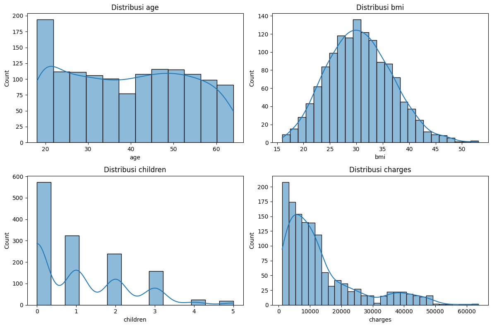
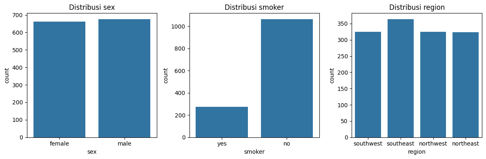
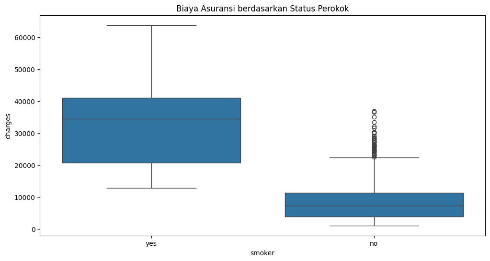
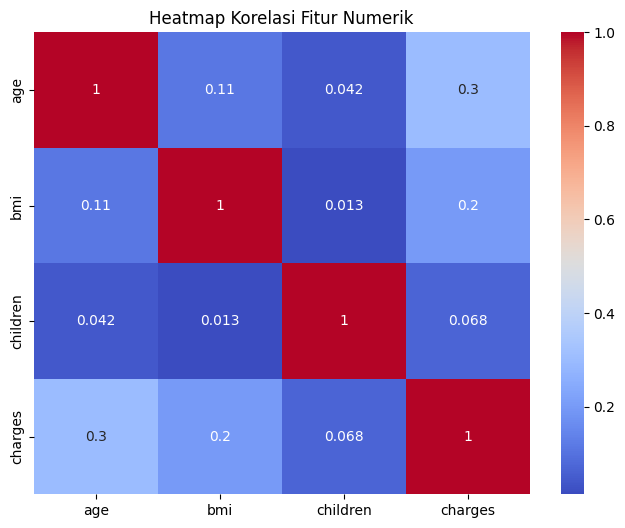

# Analisis Data Biaya Asuransi Kesehatan

## Tujuan Analisis

Analisis ini bertujuan memahami faktor-faktor yang berkaitan dengan biaya asuransi kesehatan (`charges`). Dataset dieksplorasi untuk menemukan pola distribusi biaya, melihat perbedaan biaya antar kelompok peserta, serta menilai kualitas data sebelum digunakan dalam analisis lanjutan atau pemodelan regresi.

Dalam peran sebagai proses analisis data, notebook ini berfokus pada:

- memahami karakteristik peserta dan pola biaya melalui Exploratory Data Analysis (EDA),
- memeriksa kualitas data, termasuk missing value, duplikat, dan outlier,
- membandingkan biaya berdasarkan karakteristik demografis dan gaya hidup,
- menyiapkan data dalam format numerik yang konsisten, dan
- menghasilkan dataset yang dapat digunakan untuk analisis atau pemodelan berikutnya.

Notebook ini belum menghasilkan model prediksi final. Kesimpulan yang disampaikan merupakan **insight deskriptif dan hasil pemeriksaan data**, bukan kesimpulan kausal atau ukuran akurasi prediksi.

Dataset yang digunakan adalah **US Health Insurance Dataset** dari Kaggle. Dataset berisi 1.338 data individu dengan atribut:

- `age`: usia peserta
- `sex`: jenis kelamin
- `bmi`: indeks massa tubuh
- `children`: jumlah anak
- `smoker`: status merokok
- `region`: wilayah tempat tinggal
- `charges`: biaya asuransi sebagai target

Notebook `preprocessing/Eksperimen_RizqiFathurrohman.ipynb` digunakan untuk eksplorasi dan dokumentasi analisis, sedangkan script `preprocessing/automate_RizqiFathurrohman.py` mengotomatisasi proses pembersihan dan transformasi data.

## Alur Analisis

1. Dataset dimuat dari `insurance_raw/insurance.csv`.
2. Struktur data, statistik deskriptif, missing value, distribusi fitur, distribusi kategori, biaya berdasarkan status perokok, dan korelasi fitur numerik diperiksa melalui EDA.
3. Satu baris duplikat dihapus sehingga tersisa 1.337 baris.
4. Outlier disaring dengan metode IQR pada `age`, `bmi`, `children`, dan `charges`. Karena penyaringan dilakukan pada semua kolom numerik sekaligus, data berkurang menjadi 1.192 baris.
5. Kolom kategorikal diubah menggunakan one-hot encoding dengan `drop_first=True`:
   - `sex` menjadi `sex_male`
   - `smoker` menjadi `smoker_yes`
   - `region` menjadi `region_northwest`, `region_southeast`, dan `region_southwest`
6. `charges` dipisahkan sebagai target, sedangkan delapan kolom lainnya digunakan sebagai fitur.
7. Fitur distandardisasi menggunakan `StandardScaler` sehingga setiap fitur memiliki skala yang sebanding.
8. Hasil disimpan ke `preprocessing/insurance_preprocessing/insurance_preprocessed.csv`.

## Insight Analisis

- Dataset awal tidak memiliki missing value pada seluruh tujuh kolom, sehingga tidak diperlukan imputasi.
- `charges` memiliki rentang yang lebar, dari sekitar 1.121,87 hingga 63.770,43. Nilai rata-rata sekitar 13.270,42 lebih tinggi daripada median sekitar 9.382,03, yang menunjukkan distribusi biaya menceng ke kanan dan dipengaruhi oleh sebagian biaya yang sangat tinggi.
- Perbedaan biaya antara perokok dan bukan perokok terlihat paling menonjol dalam EDA. Temuan ini menunjukkan bahwa status merokok merupakan variabel penting untuk dianalisis lebih lanjut ketika menjelaskan variasi biaya.
- Usia dan BMI berpotensi membantu menjelaskan variasi biaya, sedangkan informasi jenis kelamin dan wilayah tetap dipertahankan untuk melihat apakah keduanya memberikan pola tambahan.
- Satu baris duplikat dihapus, kemudian penyaringan IQR mengurangi data dari 1.337 menjadi 1.192 baris. Langkah ini mengurangi pengaruh nilai ekstrem, tetapi perlu dipertimbangkan kembali karena biaya tinggi dapat merupakan kasus nyata, bukan kesalahan pencatatan.
- Korelasi yang ditampilkan merupakan hubungan statistik awal dan tidak dapat diartikan sebagai hubungan sebab-akibat. Untuk menyatakan pengaruh suatu faktor secara lebih kuat, diperlukan analisis lanjutan dan validasi model.

## Grafik EDA

Grafik berikut adalah visualisasi yang digunakan untuk mendukung interpretasi karakteristik data dan menemukan pola awal.

### Distribusi Fitur Numerik



Distribusi `charges` memiliki ekor panjang dibandingkan fitur numerik lainnya. Hal ini menunjukkan adanya variasi biaya yang besar dan menjadi alasan untuk memeriksa nilai ekstrem sebelum analisis lanjutan.

### Distribusi Fitur Kategorikal



Grafik ini memperlihatkan komposisi peserta berdasarkan jenis kelamin, status merokok, dan wilayah. Komposisi kategori penting diperhatikan agar perbandingan antar kelompok tidak dibaca tanpa mempertimbangkan jumlah observasinya.

### Biaya Berdasarkan Status Perokok



Perbandingan ini menunjukkan bahwa sebaran `charges` pada perokok cenderung jauh lebih tinggi daripada bukan perokok. Ini merupakan insight utama dari analisis deskriptif, tetapi belum membuktikan bahwa status merokok adalah satu-satunya penyebab perbedaan biaya.

### Korelasi Fitur Numerik



Heatmap ini menunjukkan hubungan linear antarfitur numerik. Visualisasi ini membantu mengidentifikasi pola hubungan awal, tetapi tidak cukup untuk menyimpulkan hubungan sebab-akibat.

## Output

File `insurance_preprocessed.csv` berisi 1.192 baris dan 9 kolom:

```text
age,bmi,children,sex_male,smoker_yes,
region_northwest,region_southeast,region_southwest,charges
```

Delapan kolom fitur sudah distandardisasi. Kolom `charges` tetap berada pada nilai asli agar dapat digunakan sebagai target regresi dan dibandingkan langsung dengan nilai biaya sebenarnya.

## Kesimpulan Analisis

Berdasarkan analisis deskriptif, biaya asuransi pada dataset memiliki variasi yang besar dan distribusi yang menceng ke kanan. Status merokok menjadi pembeda paling jelas dalam sebaran biaya, sementara usia, BMI, jumlah anak, jenis kelamin, dan wilayah dapat digunakan sebagai variabel pendukung untuk analisis yang lebih komprehensif.

Data telah diperiksa, dibersihkan, diubah ke format numerik, dan distandardisasi sehingga siap digunakan pada tahap analisis lanjutan. Namun, notebook belum melakukan training dan evaluasi model, sehingga belum dapat digunakan untuk menyatakan seberapa akurat biaya asuransi dapat diprediksi. Tahap berikutnya adalah membangun model regresi, mengukur MAE atau RMSE dan `R²`, serta membandingkan hasil dengan dan tanpa penghapusan outlier.

## Menjalankan Preprocessing

Dari folder `preprocessing`, jalankan:

```bash
python automate_RizqiFathurrohman.py
```

Script akan membaca dataset mentah dan menulis ulang file hasil preprocessing ke `preprocessing/insurance_preprocessing/insurance_preprocessed.csv`.

## Referensi Dataset

https://www.kaggle.com/datasets/teertha/ushealthinsurancedataset
